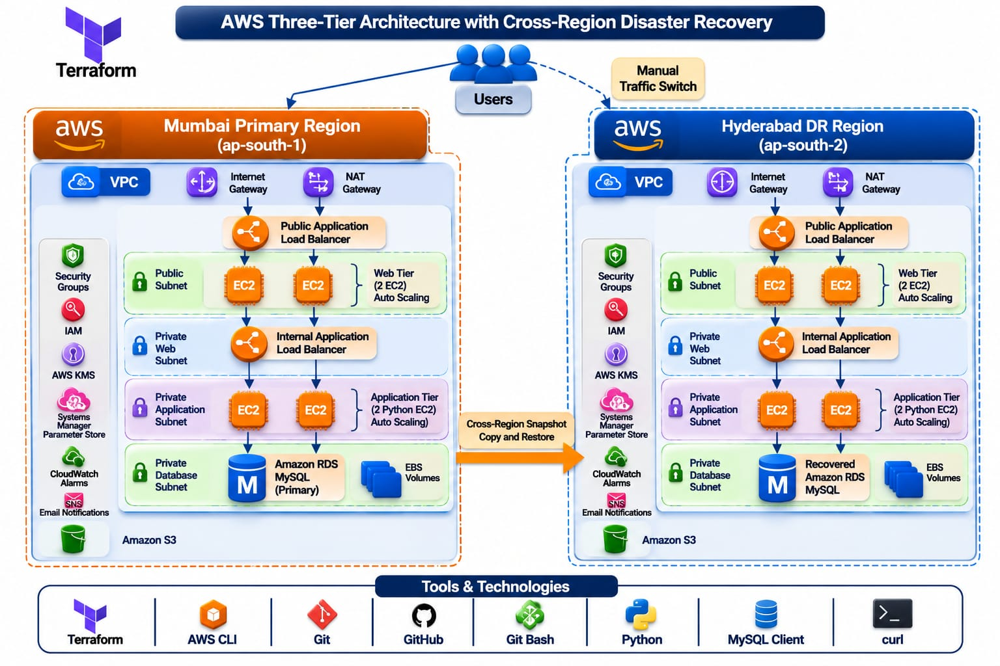

# AWS Three-Tier Architecture with Cross-Region Disaster Recovery

A highly available three-tier web application on AWS, provisioned with **Terraform** in Mumbai (`ap-south-1`), with a pre-provisioned cross-region Disaster Recovery (DR) environment in Hyderabad (`ap-south-2`).

---

## Table of Contents

- [Overview](#overview)
- [Architecture](#architecture)
- [Technology Stack](#technology-stack)
- [Primary Region: Mumbai](#primary-region-mumbai)
- [Disaster Recovery Region: Hyderabad](#disaster-recovery-region-hyderabad)
- [DR Recovery Process](#dr-recovery-process)
- [Validation and Testing](#validation-and-testing)
- [Monitoring and Notifications](#monitoring-and-notifications)
- [Project Structure](#project-structure)
- [Getting Started](#getting-started)
- [Security Practices](#security-practices)
- [Project Status](#project-status)
- [Known Limitations](#known-limitations)
- [Cost Considerations and Cleanup](#cost-considerations-and-cleanup)
- [Screenshots](#screenshots)
- [Learning Outcomes](#learning-outcomes)
- [Author](#author)

---

## Overview

| Item | Details |
|---|---|
| Primary Region | Mumbai (`ap-south-1`) |
| DR Region | Hyderabad (`ap-south-2`) |
| Infrastructure as Code | Terraform |
| DR Strategy | Backup and Restore with a pre-provisioned DR application environment |
| Database | Amazon RDS MySQL 8.4 (private and encrypted) |

This project demonstrates AWS network design, three-tier application deployment, secure configuration management, monitoring, and cross-region database recovery.

## Architecture

The architecture consists of two AWS regions: Mumbai as the primary environment and Hyderabad as the disaster recovery environment.



Traffic flows from the public Application Load Balancer to the web tier, then through an internal Application Load Balancer to the application tier, which connects to a private RDS MySQL database.

The Hyderabad DR environment contains the corresponding application infrastructure. Database recovery is performed through encrypted cross-region RDS snapshot copy and restore.

## Technology Stack

| Category | Services and Tools |
|---|---|
| Networking | Amazon VPC, Subnets, Route Tables, Internet Gateway, NAT Gateway |
| Compute | Amazon EC2, EBS |
| Auto Scaling | EC2 Auto Scaling Groups |
| Load Balancing | Public and Internal Application Load Balancers |
| Database | Amazon RDS MySQL |
| Security | IAM, Security Groups, AWS KMS |
| Configuration | AWS Systems Manager Parameter Store |
| Monitoring | Amazon CloudWatch |
| Notifications | Amazon SNS |
| Storage | Amazon S3 |
| Disaster Recovery | RDS Snapshots, Cross-Region Snapshot Copy |
| Infrastructure as Code | Terraform |
| Version Control | Git, GitHub |
| Testing and CLI | AWS CLI, Bash, curl, Python, MySQL Client |

## Primary Region: Mumbai

- **VPC CIDR:** `10.0.0.0/16`
- Public, web, application, and database subnets.
- Internet Gateway and NAT Gateway.
- Public Application Load Balancer.
- Web tier with two EC2 instances managed by Auto Scaling.
- Internal Application Load Balancer.
- Application tier with two Python EC2 instances managed by Auto Scaling.
- Private Amazon RDS MySQL database.
- IAM instance roles and SSM Parameter Store `SecureString` for database credentials.
- CloudWatch monitoring and SNS notifications.

### Primary RDS Configuration

| Setting | Value |
|---|---|
| Engine | MySQL 8.4 |
| Instance class | `db.t3.micro` |
| Storage | 20 GiB gp3 |
| Encryption | Enabled |
| Public access | Disabled |
| Deployment | Single-AZ |

## Disaster Recovery Region: Hyderabad

- **VPC CIDR:** `10.1.0.0/16`
- Separate public, web, application, and database subnets.
- Internet Gateway and NAT Gateway.
- Public and internal Application Load Balancers.
- Web tier with two EC2 instances managed by Auto Scaling.
- Application tier with two EC2 instances managed by Auto Scaling.
- Recovered private and encrypted RDS MySQL database.
- Regional SSM Parameter Store configuration.
- CloudWatch alarms and SNS email notifications.

## DR Recovery Process

1. Create a database snapshot from the Mumbai primary RDS instance.
2. Copy the encrypted snapshot to Hyderabad.
3. Restore an RDS instance from the copied snapshot.
4. Verify database authentication and connectivity from the DR application tier.
5. Switch the application endpoint manually for DR testing.

## Validation and Testing

The following tests were performed:

- Mumbai and Hyderabad endpoints `/`, `/app/`, and `/db` returned **HTTP 200**.
- Web and application target groups reported healthy targets in both regions.
- Application instances connected successfully to their respective RDS databases.
- MySQL authentication and query execution were verified.
- Cross-region RDS snapshot copy and database restoration were tested.
- Manual endpoint switching from Mumbai to Hyderabad was tested, and DR endpoints returned HTTP 200 afterward.
- Terraform formatting and validation completed successfully.
- SNS test notification emails were received from both regions.

### RPO and RTO Test Notes

- A controlled test record inserted into the Mumbai primary database was **not present** in the older Hyderabad restored snapshot. This confirms that the snapshot did not contain the later record; it does **not** establish an exact measured RPO.
- A manual endpoint-switch exercise took approximately **four seconds**. This is not a measurement of complete regional disaster recovery RTO.

## Monitoring and Notifications

Four CloudWatch alarms are configured in each region:

| Alarm | Purpose |
|---|---|
| Web target unhealthy hosts | Detects failing web tier targets |
| Application target unhealthy hosts | Detects failing application tier targets |
| RDS high CPU utilization | Flags database load |
| RDS low free storage | Flags database storage risk |

Alerts are delivered by email through regional SNS topics:

| Region | SNS Topic |
|---|---|
| Mumbai | `three-tier-primary-alerts` |
| Hyderabad | `three-tier-dr-alerts` |

Both subscriptions were confirmed and test emails were received.

> **Implementation note:** Mumbai CloudWatch alarms are managed through Terraform. Hyderabad alarms and SNS topic setup were created using the AWS CLI.

## Project Structure

```text
aws-three-tier-dr/
├── main.tf
├── dr.tf
├── providers.tf
├── variables.tf
├── locals.tf
├── monitoring.tf
├── .terraform.lock.hcl
├── .gitignore
├── docs/
│   └── aws-three-tier-dr-architecture.jpeg
├── screenshots/
└── README.md
```

## Getting Started

### Prerequisites

- An AWS account with sufficient permissions to create the required resources.
- [Terraform](https://developer.hashicorp.com/terraform/install) installed.
- [AWS CLI](https://docs.aws.amazon.com/cli/latest/userguide/getting-started-install.html) installed and configured.

### Deploy

Run these commands from the Terraform project directory:

```bash
terraform init
terraform fmt -check
terraform validate
terraform plan
terraform apply
```

> Review the Terraform plan carefully before applying changes.

### Clean Up

```bash
terraform destroy
```

**Important:** Resources created outside Terraform, including Hyderabad CloudWatch alarms, SNS resources, and manual snapshots, may need separate cleanup. Verify all dependencies before deleting anything.

## Security Practices

- Use IAM roles instead of hardcoded AWS credentials.
- Store database passwords in SSM Parameter Store `SecureString`.
- Keep databases in private subnets.
- Restrict network traffic with Security Groups.
- Encrypt RDS databases and snapshots.
- Never commit credentials, `.tfvars`, Terraform state files, or plan files to GitHub.

## Project Status

| Feature | Status |
|---|---|
| Mumbai three-tier architecture | Deployed and tested |
| Hyderabad DR network | Deployed |
| Hyderabad web and application tiers | Deployed and tested |
| Cross-region RDS snapshot copy | Tested |
| DR RDS restoration | Tested |
| Application-to-database connectivity | Tested |
| CloudWatch monitoring | Configured |
| SNS email notifications | Tested |
| Manual DR endpoint-switch drill | Tested |
| Automated regional failover | Not implemented |
| Route 53 failover | Not implemented |
| HTTPS and custom domain | Not implemented |
| Exact measured RPO and full regional RTO | Not established |

## Known Limitations

- Failover is **manual**; automated failover and Route 53 failover are not implemented.
- HTTPS and a custom domain are not configured.
- RPO and full regional RTO have not been formally measured.
- The primary database is Single-AZ.
- Hyderabad alarms and SNS were configured using AWS CLI, not Terraform.

### Possible Future Improvements

- Route 53 health checks with failover routing.
- HTTPS using AWS Certificate Manager (ACM) and a custom domain.
- Multi-AZ RDS for the primary database.
- Automated, scheduled cross-region snapshot copy.
- Bring Hyderabad alarms and SNS under Terraform management.
- Formal RPO and RTO measurement.

## Cost Considerations and Cleanup

EC2, NAT Gateways, Application Load Balancers, RDS, snapshots, public IPv4 addresses, and cross-region data transfer may incur AWS charges.

Review costs regularly and clean up resources when they are no longer needed.

## Screenshots

The `screenshots/` folder contains implementation and validation evidence.

| No. | Evidence |
|---|---|
| 01–02 | Mumbai and Hyderabad VPCs |
| 03–04 | Subnets |
| 05–06 | Route Tables |
| 07–10 | Internet and NAT Gateways |
| 11–12 | Security Groups |
| 13–16 | Public and Internal Load Balancers |
| 17–18 | EC2 Instances |
| 19–20 | Auto Scaling Groups |
| 21–24 | Target Groups |
| 25–27 | Primary, DR, and Recovered RDS |
| 28–29 | CloudWatch Alarms |
| 30–31 | SNS Subscriptions |
| 32 | Primary and DR Connectivity Test |
| 33 | Manual Failover Test |
| 34 | Database Recovery Validation |
| 35 | Terraform Validation |
| 36 | GitHub Repository |

[Browse all project screenshots](screenshots/)

## Learning Outcomes

- AWS VPC and subnet design.
- Three-tier application deployment.
- EC2 Auto Scaling and load balancing.
- RDS MySQL configuration.
- IAM and secure parameter management.
- Terraform infrastructure provisioning.
- Cross-region snapshot copy and restore.
- CloudWatch monitoring and SNS notifications.
- Disaster Recovery validation.

## Author

**Berlin**

AWS | Terraform | DevOps | Cloud Infrastructure | Disaster Recovery
