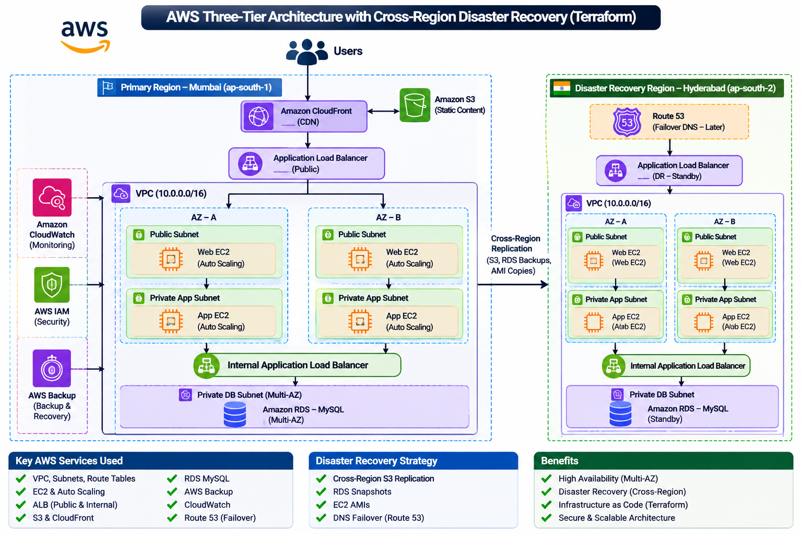

# AWS Three-Tier Architecture with Cross-Region Disaster Recovery

## Project Overview

This project demonstrates a three-tier web application architecture on AWS, provisioned using Terraform, with a cross-region Disaster Recovery (DR) approach.

The primary application runs in Mumbai (`ap-south-1`). A backup-and-restore DR environment is configured in Hyderabad (`ap-south-2`).

## Architecture



- **Primary Region:** Mumbai (`ap-south-1`)
- **DR Region:** Hyderabad (`ap-south-2`)
- **Infrastructure as Code:** Terraform

### Primary Architecture Flow

```text
Internet
   |
Public Application Load Balancer
   |
Web EC2 Auto Scaling Group
   |
Internal Application Load Balancer
   |
Application EC2 Auto Scaling Group
   |
Amazon RDS MySQL
```

### Disaster Recovery Flow

```text
Mumbai Primary RDS
       |
Encrypted RDS Snapshot
       |
Cross-Region Snapshot Copy
       |
Hyderabad RDS Restore
       |
Private Database Connectivity Test
```

## AWS Services Used

| Category | Services |
|---|---|
| Networking | VPC, Subnets, Route Tables, Internet Gateway, NAT Gateway |
| Compute | EC2 |
| Auto Scaling | EC2 Auto Scaling Groups |
| Load Balancing | Public and Internal Application Load Balancers |
| Database | Amazon RDS MySQL |
| Security | IAM Roles, Security Groups, AWS KMS |
| Configuration and Secrets | AWS Systems Manager Parameter Store |
| Disaster Recovery | RDS Snapshots, Cross-Region Snapshot Copy |
| Infrastructure as Code | Terraform |
| CLI | AWS CLI |

## Primary Region — Mumbai

- VPC CIDR: `10.0.0.0/16`
- Public and private subnet architecture.
- Public Application Load Balancer.
- Web EC2 Auto Scaling Group with two instances.
- Internal Application Load Balancer.
- Application EC2 Auto Scaling Group with two instances.
- Amazon RDS MySQL in private database subnets.
- NAT Gateway for outbound connectivity.
- Database password stored in Systems Manager Parameter Store as SecureString.
- IAM instance roles for AWS access.

### Primary RDS Configuration

- Engine: MySQL 8.4
- Instance class: `db.t3.micro`
- Storage: 20 GiB gp3
- Encryption: Enabled
- Public access: Disabled
- Deployment: Single-AZ

## Disaster Recovery — Hyderabad

- DR Region: `ap-south-2`
- DR VPC CIDR: `10.1.0.0/16`
- Private database subnets.
- Database security group and DB subnet group.
- Encrypted cross-region RDS snapshot copy.
- Restored MySQL database in Hyderabad.
- Database connectivity and authentication tested successfully.

**DR approach:** Backup and Restore.

The current DR environment covers database restoration and connectivity testing. It does not yet include a complete web/application stack or automated failover.

## Recovery Validation

The following tests were performed:

- Primary application endpoints `/`, `/app/`, and `/db` returned HTTP 200.
- Primary RDS instance reached Available status.
- Encrypted RDS snapshot copied to Hyderabad.
- DR RDS instance restored and reached Available status.
- DR database remained private and encrypted.
- MySQL authentication and connectivity tested from a temporary SSM-managed EC2 instance.
- Temporary DR test infrastructure was removed after testing.

**Data recovery limitation:** The restored `appdb` database contained zero tables during validation. Database infrastructure restoration and connectivity were tested, but recovery of actual application table data has not yet been demonstrated.

## Terraform Project Structure

```text
aws-three-tier-dr/
│
├── main.tf
├── dr.tf
├── providers.tf
├── variables.tf
├── locals.tf
├── .terraform.lock.hcl
├── .gitignore
├── docs/
│   └── architecture.png
├── screenshots/
└── README.md
```

## Deployment Commands

Run these commands from the Terraform project directory:

```bash
terraform init
terraform fmt -check
terraform validate
terraform plan
terraform apply
```

Review the Terraform plan carefully before applying changes.

## Security Practices

- Use IAM roles instead of hardcoding AWS credentials.
- Store database passwords in SSM Parameter Store SecureString.
- Keep databases in private subnets.
- Restrict traffic using security groups.
- Encrypt RDS databases and snapshots.
- Do not commit credentials, `.tfvars` files, Terraform state files, or plan files to GitHub.

## Project Status

**Primary three-tier deployment:** Implemented and tested.

**Cross-region database DR:** Snapshot copy, restore, and connectivity testing completed.

**Remaining improvements:**
- Deploy the web and application tiers in Hyderabad.
- Demonstrate recovery of actual application database data.
- Document and test the complete recovery runbook.
- Measure Recovery Point Objective (RPO) and Recovery Time Objective (RTO).
- Implement monitoring and alerting.
- Configure HTTPS and a custom domain.

## Cost Considerations

AWS resources such as EC2, NAT Gateway, Application Load Balancers, RDS, snapshots, public IPv4 addresses, and cross-region data transfer may incur charges.

Review and clean up resources when they are no longer needed.

## Learning Outcomes

- AWS VPC and subnet design.
- Public and private network architecture.
- Three-tier application deployment.
- EC2 Auto Scaling and load balancing.
- Amazon RDS MySQL configuration.
- IAM and secure parameter management.
- Terraform infrastructure provisioning.
- Cross-region RDS snapshot copy and restore.
- Disaster Recovery validation.

## Author

Berlin

AWS | Terraform | DevOps | Cloud Infrastructure | Disaster Recovery